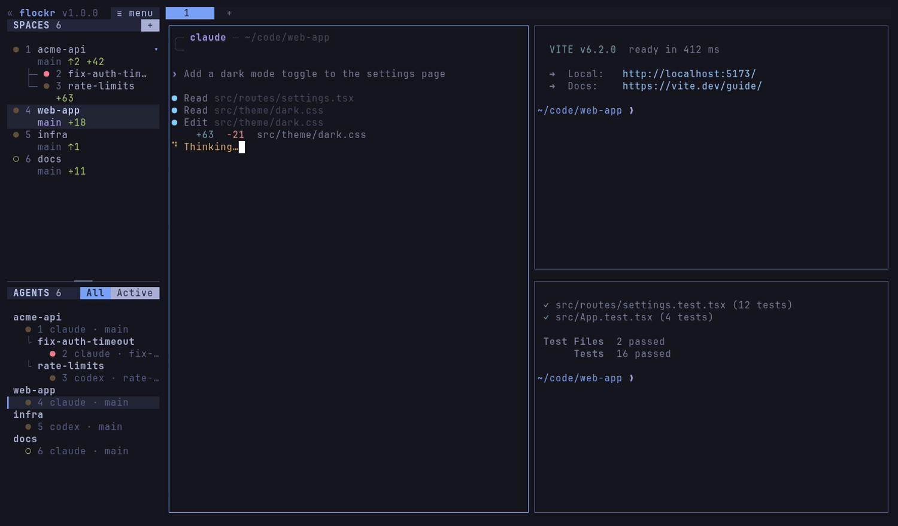

# flockr

A terminal workspace for running many coding agents side by side. Spaces,
tabs, and split panes, with a sidebar that shows which agents are working,
waiting on you, or done.



flockr is a hard fork of [herdr](https://github.com/herdrdev/herdr) by Can
Celik and contributors (Apache-2.0). It runs beside a stock herdr without
either one seeing the other.

## Install

macOS and Linux:

```bash
curl -fsSL https://raw.githubusercontent.com/flockr-sh/flockr/master/distribution/install.sh | sh
```

This installs to `~/.local/bin` (set `FLOCKR_INSTALL_DIR` to change it) and
checks the SHA-256 of the download.

Windows:

```powershell
powershell -ExecutionPolicy Bypass -c "irm https://raw.githubusercontent.com/flockr-sh/flockr/master/distribution/install.ps1 | iex"
```

[mise](https://mise.jdx.dev):

```bash
mise use -g github:flockr-sh/flockr
```

Binaries for each release are also on the
[releases page](https://github.com/flockr-sh/flockr/releases).

### Build from source

Needs Rust (via [rustup](https://rustup.rs)) and Zig 0.16.0; with
[mise](https://mise.jdx.dev), `mise install` in the repo sets up Zig.

```bash
mise exec -- cargo build --release --locked
ln -sf "$PWD/target/release/flockr" ~/.local/bin/flockr
```

## Quick start

```bash
flockr                              # start, or attach to your running session
flockr integration install claude   # report agent state (also codex, pi, opencode, …)
```

The prefix key is `ctrl+b`, as in tmux.

| Keys | What it does |
|---|---|
| `prefix+?` | Show every key |
| `prefix+s` | Settings |
| `prefix+:` | Command palette: search every action |
| `prefix+a` | Jump to the next agent that needs you |
| `prefix+v`, `prefix+minus` | Split right, split down |
| `prefix+space` | Cycle layout presets |
| `prefix+f` | Open or copy a link on screen |
| `alt+1..9`, `alt+shift+1..9` | Jump to an agent, jump to a space |

Settings live in `~/.config/flockr/config.toml`. The settings screen covers
the common ones, and `flockr --default-config` prints every option with its
documentation.

## What flockr adds to herdr

Sidebar:

- A title row with the menu. Agents sit under one header per space, and a
  worktree's agents nest under their repo the way the spaces list shows them.
- All and Active tabs filter the agents list.
- Agent rows can show the agent's own branch (`branch`), following it into
  the worktree it works in. Space rows show uncommitted changes (`diff_stat`),
  worktree spaces included.
- Agents and spaces are numbered, with keys to jump to them.
- `ui.sidebar_position = "right"` moves the sidebar to the right edge.

Agents:

- `ui.seen_delay_ms` and `ui.seen_scope`: a done agent keeps its done badge
  until its pane has been on screen long enough, so stepping through agents
  doesn't clear the ones you pass. `prefix+u` marks one done again.
- `ui.keep_agents_in_use_first`: a pane whose agent starts a fresh session
  moves behind the agents in use, and a dotted ring marks fresh sessions.
- Resumed agents keep the CLI options they were started with. Codex runs
  without its shared daemon, so its hooks see the pane.

Keys, layout, and settings:

- A settings screen in sections; changes save to the config file and apply
  at once.
- The command palette, and vim jump keys in lists.
- Link hints, tmux layout presets, and tmux's split and resize keys.
- Custom command popups are titled with their description.

Runs beside herdr:

- Its own binary, config dir (`~/.config/flockr`), socket, `FLOCKR_*`
  environment variables, and agent hooks.
- Plugins and configs written for herdr work unchanged.

See [CHANGELOG.md](CHANGELOG.md) for each release.

## Platforms

flockr is developed on Linux. Release binaries are built for macOS and
Windows too, but those come from herdr's code and have not been tested in
flockr yet.

## Contributing

Pull requests are welcome, AI-written ones included. See
[CONTRIBUTING.md](CONTRIBUTING.md).

## License

Apache-2.0, same as herdr. See [LICENSE](LICENSE). Most of the code is
herdr's; files in this repository have been modified from it.
